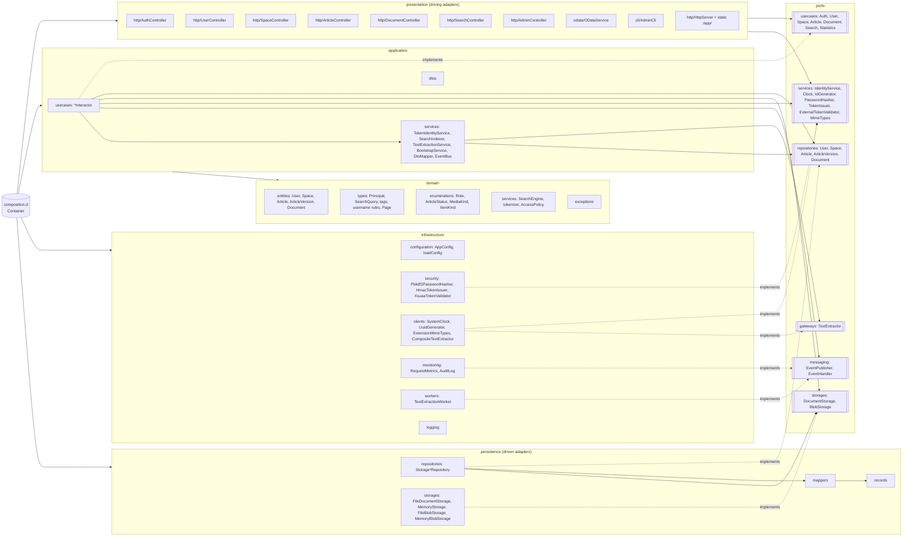
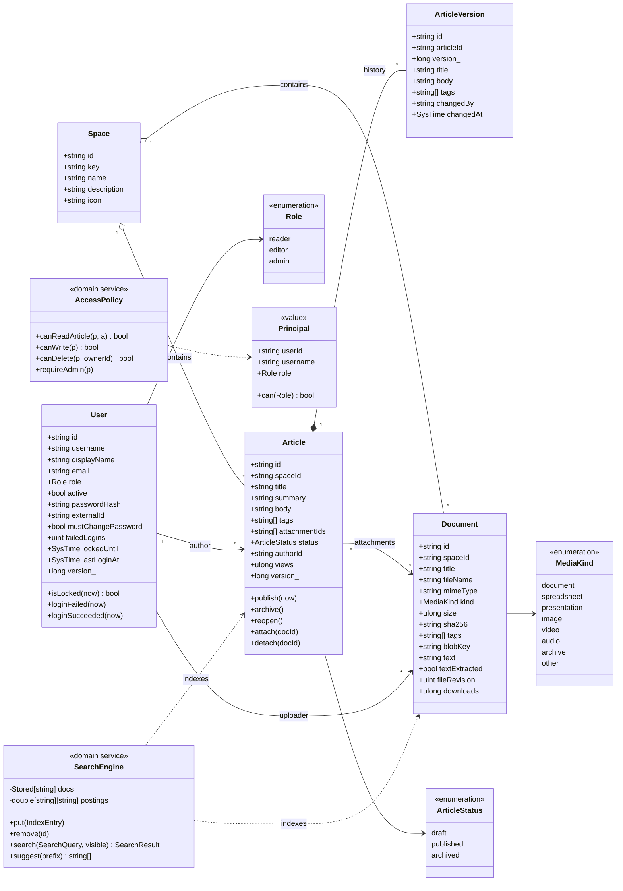
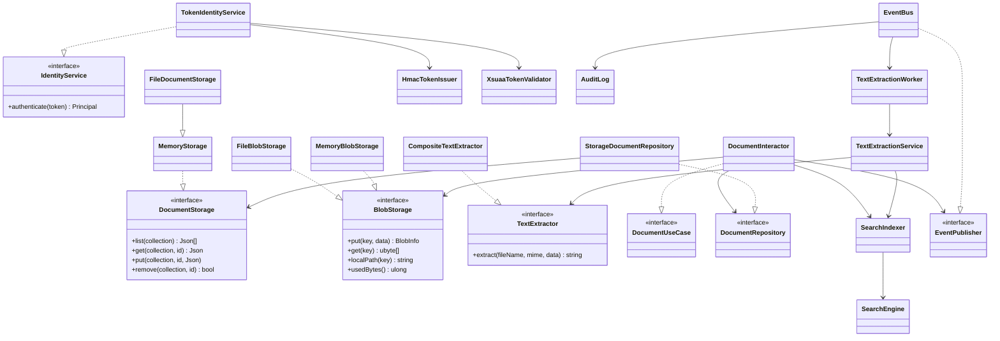
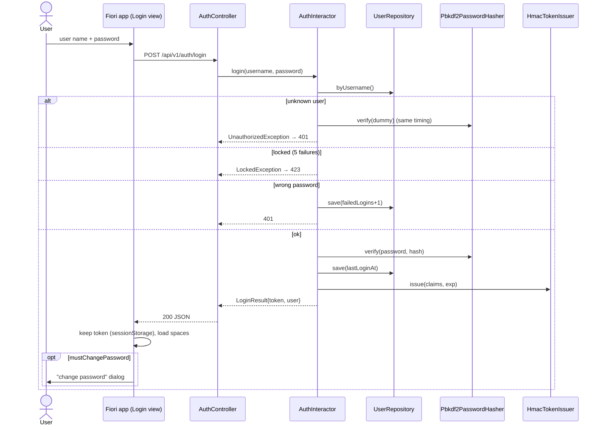
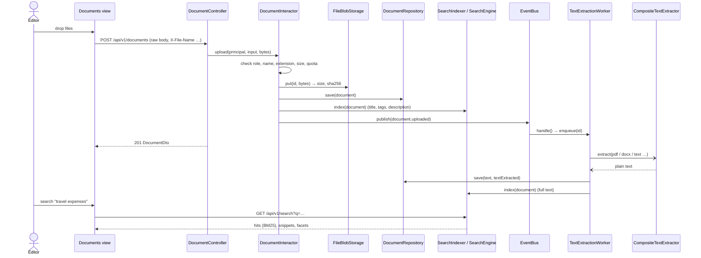
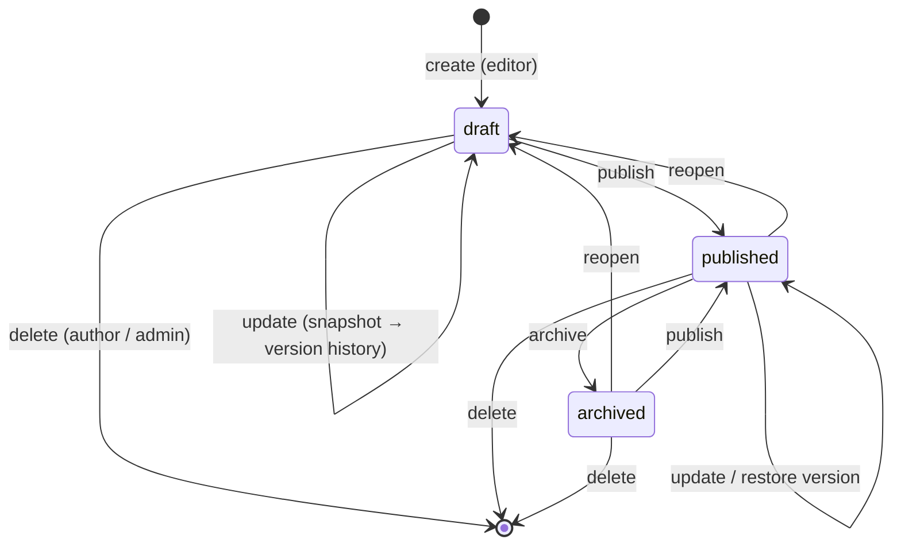
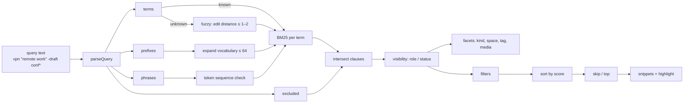
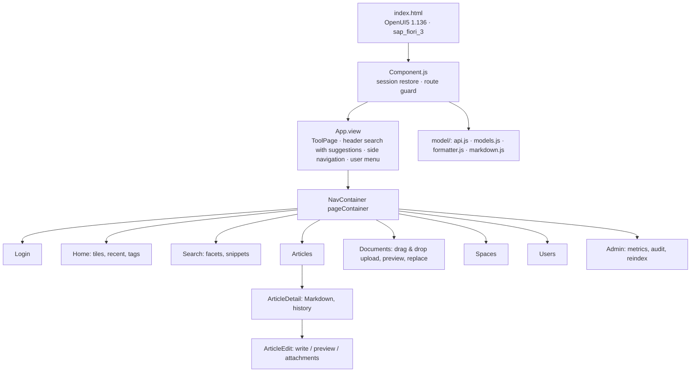
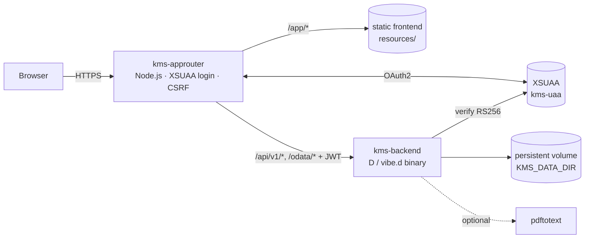

# uim KMS: UML

Diagrams in Mermaid (rendered by GitHub, GitLab and VS Code). Source code:
[backend/source/uim/myfiori/](backend/source/uim/myfiori/), [frontend/](frontend/).

## 1. Component diagram (hexagonal layers)

Dependency rule: arrows point inward. `domain` imports only Phobos. `application` imports `domain`
and `ports`. Adapters (`presentation`, `persistence`, `infrastructure`) depend on ports, and the
composition root is the only module that knows every concrete class.

## 2. Domain class diagram

## 3. Ports and adapters (class diagram)

## 4. Sequence: login

## 5. Sequence: upload, text extraction and search

## 6. State machine: article lifecycle

## 7. Search engine internals

Index structure: `postings[term][docId] = weighted tf` (title 3, tag 2, summary 1.5, text 1). The engine
also keeps per-document token lists for phrase matching and weighted lengths for the BM25 length
normalisation (k1 = 1.2, b = 0.75).

## 8. Frontend structure

## 9. Deployment

